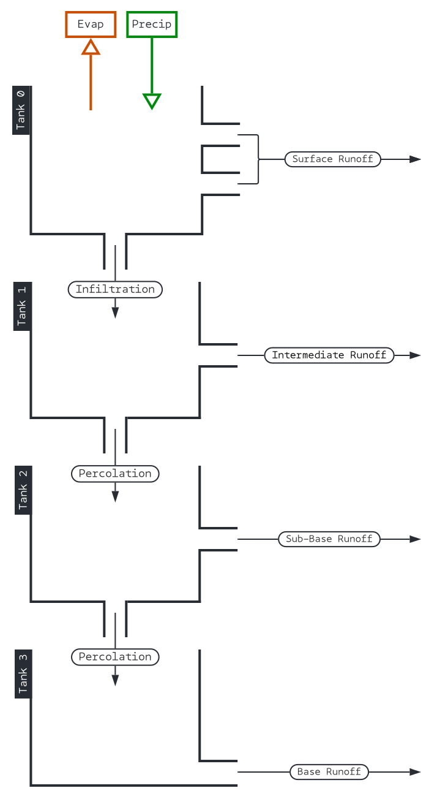

# Tank Hydrologic Model  
Python implementation of the Tank Hydrologic Model, a conceptual rainfall-runoff model proposed by Sugawara and Funiyuki (1956).


<p align="center">

</p>

### Installation

Tank-Model can be installed from PyPI:

```bash
$ pip install tank-model
```

Or install it directly from GitHub:

```bash
$ pip install https://github.com/nzahasan/tank-model/zipball/main
```

After installation, the `tank_cmd` command-line tool is available. Use it to create a new project, calibrate (optimize) its parameters, and run the simulation.

```bash
# show help for the command-line tool
$ tank_cmd --help

# show help for a subcommand
$ tank_cmd new-project --help
```

### Setting up a new model

Create a new project with the command below. It creates a folder with the project name in the current directory, containing a JSON project definition file.
```bash
$ tank_cmd new-project project_name
```

A sample project definition:
```json
{
  "interval": 24.0,
  "basin": "sample_project.basin.json",
  "precipitation": "sample_project.pr.csv",
  "evapotranspiration": "sample_project.et.csv",
  "discharge": "sample_project.q.csv",
  "result": "sample_project.result.csv",
  "statistics": "sample_project.stats.json",
  "start": "2020-01-01T00:00:00",
  "end": "2020-12-31T00:00:00"
}
```
`interval` is the simulation time step in hours. The other attributes are file paths. `precipitation`, `evapotranspiration` and `discharge` are CSV time-series files and must follow the format described in [file-format-spec.md](file-format-spec.md).

`start` and `end` are optional. They limit `compute`, `optimize` and `plot-result` to the given date range (format `%Y-%m-%dT%H:%M:%S`, same as in the time-series files). If both are omitted, the full period in the input files is used. You can set just one of them; the range is then open on the other side.

`precipitation` and `evapotranspiration` are the model inputs. The simulated output is written to the `result` file, using the same time-series CSV format. Observed flow in `discharge` is used to calibrate the model, and performance metrics (RMSE, NSE, R², PBIAS) are written to the `statistics` file.


### Converting HEC-HMS basin to tank model basin

Convert an HEC-HMS basin file into a tank model basin file:

```bash
$ tank_cmd hms2tank -bf hechms_basin_file -of output_tank_basin_file_path
```

### Computing tank model

Run the simulation for a project using its current parameters:

```bash
$ tank_cmd compute -pf project_name.project.json
```

### Optimizing (calibrating) the tank model

Automatically calibrate the model parameters against the observed discharge:

```bash
$ tank_cmd optimize -pf project_name.project.json
```

### Known Limitations

  - Optimization only supports basins with a single outlet (root node). If a basin has more than one root node, only the first one is used.

### References:  
1. Paik K., Kim J. H., Kim H. S., Lee D. R. (2005) A conceptual rainfall-runoff model considering seasonal variation.
2. Aguilar C., Polo M. J. (2011) Generating reference evapotranspiration surfaces from the Hargreaves equation at watershed scale.
3. Taib A. T. M., Tahir W., Ramli S., Mohtar I. S. A. (2022) Hydro-Meteorological Flood Forecasting Using Tank Model With Satellite-Based Rainfall Input For Kemaman River Catchment.
4. D. N. Moriasi, J. G. Arnold, M. W. Van Liew, R. L. Bingner, R. D. Harmel, T. L. Veith (2007) Model Evaluation Guidelines For Systematic Quantification Of Accuracy In Watershed Simulations.
